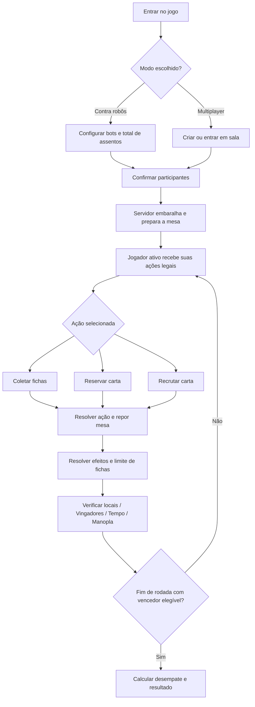

# 03 — Fluxo do jogo, estados e turnos

## Visão geral — fluxo digital proposto

## Estados de sala e de partida (propostos)

| Estado | Significado | Ações permitidas |
|---|---|---|
| `LOBBY` | Sala ainda não começou | Entrar, sair, alterar slots de bots, iniciar |
| `INITIALIZING` | Sorteio e distribuição no servidor | Nenhuma ação de jogo |
| `IN_PROGRESS` | Rodadas normais | Uma ação principal por turno |
| `AWAITING_TOKEN_RETURN` | Jogador precisa devolver excedente | Escolher fichas para devolver |
| `AWAITING_LOCATION_CHOICE` | Jogador pode conquistar vários Locais | Selecionar exatamente um |
| `FINAL_ROUND` | Ao menos um participante está elegível à Manopla | Concluir rodada, reavaliar elegibilidade |
| `FINISHED` | Resultado final calculado | Ver resumo, jogar novamente |
| `CANCELLED` | Sala cancelada antes de concluir | Retornar ao lobby |

`AWAITING_*` podem ser **subestados** de `IN_PROGRESS`/`FINAL_ROUND`, evitando perder contexto da rodada.

## Pipeline autoritativo por turno

1. Receber um comando do jogador **ativo**, com `matchId`, `turnId`, `actionId` e parâmetros.
2. Verificar autenticação/slot, versão de estado, turno e regras de custo/estoque.
3. Aplicar **uma** ação principal; gastar/devolver recursos; reservar ou recrutar; repor cartas expostas.
4. Se houve recrutamento: atualizar bônus/pontos/símbolos; conceder verde ao primeiro nível 3; avaliar posse de Vingadores.
5. Se terminou com mais de 10 fichas: solicitar devolução, sem passar o turno.
6. No final do turno: verificar Locais; se mais de um, pedir seleção de um.
7. Recalcular pontos totais = pontos dos personagens + 3 × Locais + (3 se possuir Vingadores).
8. Avaliar requisitos da Manopla e evento de rodada final.
9. Registrar evento(s), persistir snapshot/versionamento, enviar somente visão permitida a cada cliente.
10. Avançar ao próximo jogador **apenas quando todos os efeitos/decisões obrigatórios estiverem concluídos**.

**Regra especial:** se uma pessoa iniciou a rodada final mas perdeu pontos do cartão de Vingadores para outro jogador, é obrigatório verificar se **alguém ainda atende aos requisitos**. Se ninguém atender ao final da rodada, a partida prossegue.

## Rodadas

- Definir `firstSeatIndex` ao iniciar a partida.
- Uma rodada é um ciclo de turnos em que cada assento atua uma vez.
- Manter `turnsTakenByPlayer` para garantir igualdade de turnos no encerramento.
- Ao sinalizar final, guardar a rodada-alvo e só terminar após todos os assentos agirem nessa rodada.
- Um bot é um participante comum na ordem de turnos.

## Informações públicas e privadas

**Públicas:** jogadores, fichas de cada jogador, bônus, cartas recrutadas, pontuação, locais, quantidade de reservas, dono dos Vingadores, cartas abertas, tamanho restante dos baralhos, jogador da vez.

**Privadas:** identidade das cartas reservadas por compra cega do baralho de outro jogador e ordem dos baralhos. Exibir reserva individual apenas ao dono; ocultar cartas ainda nos baralhos.

## Exemplo resumido de turno

1. Jogadora recruta uma carta pública; servidor valida pagamento após descontos.
2. Servidor coloca a carta na coleção e revela substituta no mesmo nível.
3. Atualiza Vingadores e concede verde, se a carta for seu primeiro nível 3.
4. Confere se pode conquistar Local e se foi ultrapassado o limite de 10 fichas.
5. Atualiza pontuação e condições da Manopla.
6. Registra o turno e muda a vez.

## Fontes e grau de confiança

- **Regra primária:** [Space Cowboys, manual oficial em inglês (PDF)](https://cdn.svc.asmodee.net/production-spacecowboys/uploads/2025/11/Rules_Splendor_Marvel_EN_compressed.pdf), páginas 1–3. Publicação oficial da editora.
- **Tradução:** [Manual em português (PDF)](https://comparajogos-forum.s3.dualstack.sa-east-1.amazonaws.com/uploads/original/2X/3/322af301ee614024f9f26a0d666a10db365ee8e7.pdf), páginas 1–3.
- **Composição:** [Página da editora Space Cowboys](https://www.spacecowboys-games.com/game/splendor-marvel/).
- **Identidade das 90 cartas por nível:** [Marvel Splendor Card List — Scribd](https://www.scribd.com/document/793036882/Marvel-Splendor-Card-List), **lista comunitária não oficial**, comparada pontualmente com exemplos/fotos públicas. **A lista completa ainda requer auditoria com exemplar físico ou imagens legíveis das 90 cartas.**

**Legenda:** `oficial` = regra/componente confirmado pelo manual; `comunidade_a_validar` = catálogo nominal encontrado, não verificado carta a carta; `pendente` = dado desconhecido. Não tratar `null` como 0.
